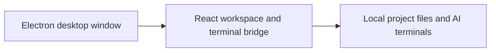

# Seanwiki

## Architecture

A Mac workspace for people who use more than one AI coding tool on the same project.

### Follow one interaction

Open a project and the workspace brings its notes and terminal together. Claude Code or Codex can work in that project while its decisions stay in files that can be read again next session.

## APIs and interfaces

| Connection | What crosses it |
| --- | --- |
| React renderer → Electron main process | Electron IPC connects the desktop controls with project and terminal operations. This is a call between two processes on the same computer. |
| Terminal bridge → coding tools | A Python pseudo-terminal carries typed input and terminal output between the workspace and an AI CLI. Project notes are ordinary files. |

### Why it works this way

Keeping the notes on disk lets a developer inspect or correct a decision independently of the conversation that produced it. A project instruction describes intent; operating-system permissions still govern file access.

## Source in this repository

Read [usage-display.ts](usage-display.ts) to see how the workspace distinguishes fresh usage limits from stale readings. This is an excerpt from the original app.

## Try a project handover

Run `node read-notes.mjs` with Node.js 24 or newer. It reads a fictional project decision using the same [note reader](project-notes.ts) that feeds the desktop workspace. Edit the [sample note](sample-project/wiki/listing-prices.md) and rerun the command to see what the next coding session can pick up.

[Back to the project index](https://github.com/IT-Yun/IT-Yun)
